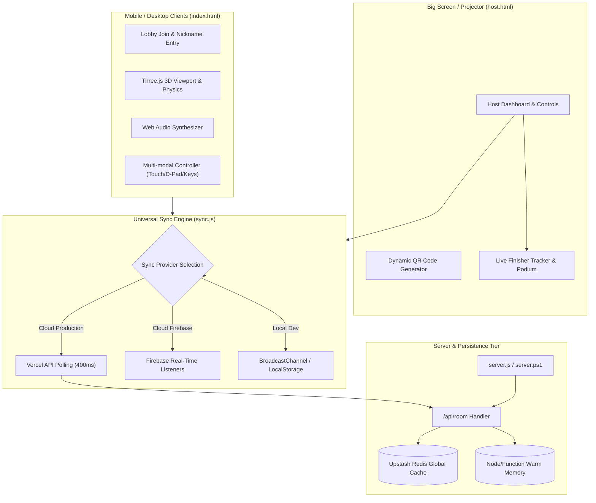

# 🏛️ Comprehensive Codebase & Architecture Analysis Report: ACM Maze Quest (3D v2.0)

**Project Name**: ACM Maze Quest (3D v2.0)  
**Classification**: Real-Time Multiplayer 3D Procedural Labyrinth & Audience Engagement Platform  
**Architecture Paradigm**: Client-Server Hybrid (Kahoot-Style Lobby + Serverless State Management + Localized WebGL 3D Game Engine)  
**Report Generation Date**: October 2026  
**Audience**: Software Engineers, Technical Architects, Game Developers, Chapter Leads  

---

## 📋 Executive Summary

**ACM Maze Quest 3D v2.0** is an interactive, Kahoot-style procedural 3D maze competition engineered for large live audiences (up to 300 concurrent players). Players join instantly via mobile devices by scanning a dynamically generated QR code on a shared projector screen without needing native app installations or user account registrations.

Each participant navigates a procedurally generated 3D dark-dungeon labyrinth using a follow-camera viewport, hunting for three mystical runes (**A**, **C**, and **M**) under a strict server-synchronized countdown timer. When runes are gathered or the global countdown expires, the server orchestrates an animated podium reveal showcasing top rankings, completion timestamps, and total step metrics.

### Key Metrics & Stack Composition
- **Frontend / Rendering**: Three.js (r128) WebGL 3D, HTML5 Canvas, Vanilla CSS3 (Glassmorphism & Neon Dark Theme).
- **Audio Pipeline**: Zero-asset procedural synthesis via native Web Audio API oscillators.
- **Backend / Synchronization**: 
  - Vercel Serverless Function (`/api/room.js`) backed by Upstash Redis (REST API) with in-memory caching.
  - Native Node.js HTTP server (`server.js`) with zero external runtime dependencies.
  - Optional Firebase Cloud Firestore integration.
  - Local cross-tab fallback via `BroadcastChannel` and `localStorage`.
- **Portability**: Supports multi-platform serving via Node.js (`server.js`), Windows PowerShell TCP Listener (`server.ps1`), and cloud hosting (Vercel).

---

## 🗺️ Architectural Topology & System Flow



---

## 📂 Detailed File-by-File Breakdown

### 1. `server.js` (Local Node.js Development Server)
- **Role**: Lightweight, zero-dependency HTTP server tailored for local hackathons and offline classroom competitions.
- **Key Responsibilities**:
  - Automatically identifies local non-internal IPv4 interfaces (`os.networkInterfaces()`) to display the exact Wi-Fi address for mobile devices.
  - Mounts the serverless `/api/room.js` endpoint directly inside Node's native `http.createServer` lifecycle.
  - Decorates request/response objects with Express-like helpers (`req.query`, `req.body`, `res.status()`, `res.json()`).
  - Implements path sanitization (`path.normalize` and stripping `..`) to mitigate directory traversal exploits.
  - Sets appropriate MIME types (`.html`, `.css`, `.js`, `.json`, `.png`, `.jpg`, `.svg`, `.ico`) and non-caching HTTP headers.
- **Architectural Strengths**:
  - Zero external npm packages required (`package.json` contains no runtime `dependencies`), allowing immediate `node server.js` execution anywhere.
  - Solves the local subnet discovery barrier by logging the exact mobile-ready Wi-Fi URL.

---

### 2. `api/room.js` (Serverless Room Controller & Redis Persistence)
- **Role**: The centralized server-authoritative state coordinator, compatible with Vercel Serverless Functions and standalone Node.js.
- **State Schema**:
  ```json
  {
    "id": "ACM2026",
    "status": "LOBBY", // "LOBBY" | "COUNTDOWN" | "STARTED" | "ENDED"
    "timeLimit": 120,
    "startTime": 1728900000000,
    "countdownStart": 1728899997000,
    "matchEndTime": 1728900120000,
    "players": {
      "p_1728900001_123": {
        "id": "p_1728900001_123",
        "name": "Alex",
        "joinedAt": 1728900001000,
        "finished": true,
        "finishTimeSeconds": 48,
        "finishTimeFormatted": "00:48"
      }
    },
    "lastUpdated": 1728900049000
  }
  ```
- **State Transitions**:
  - `LOBBY` ➔ `COUNTDOWN`: Triggered by host; assigns 3000ms countdown duration and cleans player statistics.
  - `COUNTDOWN` ➔ `STARTED`: Server auto-advances when `Date.now() >= countdownStart + 3000` to prevent client desynchronization.
  - `STARTED` ➔ `ENDED`: Auto-advances when either:
    1. All registered players submit completion (`allFinished`).
    2. Global match clock expires (`Date.now() >= matchEndTime`).
- **Resilience Engineering**:
  - Incorporates circuit-breaker logic (`redisConsecutiveErrors >= 3` with 15s backoff) to bypass Redis if unreachable and switch seamlessly to warm in-memory storage (`global.__ACM_ROOMS__`).
  - Sets Upstash Redis 24-hour expiration (`EX 86400`) to prevent memory leaks and orphaned room states.

---

### 3. `sync.js` (Universal Real-Time Synchronization Engine)
- **Role**: Universal synchronization adapter operating on the client, isolating network communication from UI and game rendering logic.
- **Tiered Failover Protocol**:
  1. **Tier 1 (Firebase Firestore)**: Activated if `window.FIREBASE_CONFIG` is set and valid. Uses dynamic ES module imports (`https://www.gstatic.com/firebasejs/10.9.0/...`) to keep initial bundle size minimal.
  2. **Tier 2 (Vercel Serverless REST Polling)**: Checks `/api/room?roomId=...`. If reachable, initiates lightweight 400ms interval polling with optimistic client-side updates.
  3. **Tier 3 (Local Offline Fallback)**: Uses HTML5 `BroadcastChannel` (`acm_sync_${roomId}`) and `window.addEventListener('storage')` for instantaneous inter-tab testing without network overhead.
- **Reconnection Handling**:
  - Evaluates player IDs and case-insensitive nicknames during `joinPlayer()` to allow seamless rejoin on network disconnection or browser refresh without forfeiting progress.

---

### 4. `game.js` (Three.js 3D Viewport & Game Engine)
- **Role**: Core WebGL 3D game engine, physics, viewport management, camera follow, and session persistence.
- **Geometry & Draw-Call Optimization**:
  - Maze rendering is batched into **Instanced Meshes** (`THREE.InstancedMesh`):
    - Ground flagstones: 1 single `InstancedMesh` holding all $16 \times 16 \times 4 = 1,024$ individual floor stones.
    - Horizontal walls: 1 `InstancedMesh` for all horizontal wall segments.
    - Vertical walls: 1 `InstancedMesh` for all vertical wall segments.
    - Corner posts: 1 `InstancedMesh` for all grid intersections.
  - **Total scene draw calls**: Less than 6 draw calls for the entire maze structure, ensuring a solid 60 FPS on low-power mobile devices.
- **Lighting & Atmospheric Design**:
  - Ambient base lighting (`0x3a4f6e`, 0.45 intensity) + Sky/Ground Hemisphere light + Moonlit directional fill.
  - Character torch: `THREE.PointLight` with `castShadow = false` (critical optimization: avoids 6 cubemap shadow passes per frame).
  - Forward flashlight: `THREE.SpotLight` with a forward-projected target, single 1024×1024 soft shadow map (`PCFSoftShadowMap`).
  - Volumetric light cone: Procedural extruded `ConeGeometry` with additive transparency (`THREE.AdditiveBlending`).
  - Orbiting energy wisps and floating atmospheric dust motes (`THREE.Points`).
- **Physics & Collision**:
  - Circle-to-AABB bounding box resolution (`resolveWallCollisions`).
  - **Sub-stepping**: High velocities are subdivided into sub-steps (`maxStep = PLAYER_COLLISION_RADIUS * 0.45`) to mathematically eradicate wall-tunneling bugs.
- **Mid-Match Session Persistence (`rehydrate`)**:
  - Player coordinates, orientation, step counts, collected runes, and maze topology are serialized to `sessionStorage` every 800ms. If a mobile user accidentally swipes down or refreshes, the game state restores instantly without loss of progress.

---

### 5. `maze.js` (Recursive Backtracker & Rune Spawner)
- **Role**: Cell-based procedural maze generation and spatial placement.
- **Algorithm**:
  - **Randomized Depth-First Search (Recursive Backtracker)** using an explicit stack to carve out guaranteed fully traversable mazes.
  - **Braid Post-Processing**: Loops over dead-end cells (cells with 3 walls intact) and knocks down walls with an 18% probability (`braidRatio = 0.18`), transforming the maze from a rigid tree into a multi-path labyrinth with loops.
  - **Constrained Rune Spawner**:
    - Disallows spawning runes within Manhattan distance $\le 5$ from the starting position.
    - Enforces a minimum distance $\ge 6$ units between runes.

---

### 6. `player.js` (Player Client Controller)
- **Role**: State orchestrator for player devices, controlling transitions between the 5 distinct screens.
- **Screen State Machine**:
  1. `screenJoin`: Nickname validation and room verification.
  2. `screenLobbyWaiting`: Waiting room with animated pulse circle and Kahoot geometric decals.
  3. `countdownOverlay`: Synchronized 3-second countdown with procedural beeps and "GO!" splash.
  4. `screenGame`: Active 3D canvas viewport, HUD letter badges, step counter, remaining timer, and on-screen D-Pad/Joystick.
  5. `screenFinishedWaiting`: Intermediate completion screen displaying run statistics (time, steps, letter sequence) while other competitors finish.
  6. `screenLeaderboard`: Final leaderboard rankings table and 3D podium.

---

### 7. `host.html` (Kahoot Big Screen & Projector Dashboard)
- **Role**: Centralized host display interface designed for presentation on large venue screens and projectors.
- **Key Modules**:
  - Real-time QR Code generator (renders via client-side `qrcode.min.js` with automated fallback to QR API).
  - Interactive participant counter and colored pill tags for each joined player.
  - Round configuration bar (customizable 60s, 90s, 120s, 180s, 240s limits).
  - Live finisher tracker showing player completions in real time.
  - Full podium sequence displaying 1st, 2nd, and 3rd place champions alongside complete standings.

---

### 8. `audio.js` (Procedural Web Audio Engine)
- **Role**: Asset-free, synthesized audio manager executing via browser `AudioContext`.
- **Sound Synthesis Specifications**:
  | Sound Effect | Waveform | Frequency Envelope | Gain & Decay |
  | :--- | :--- | :--- | :--- |
  | **Footstep** | Triangle | 110Hz–140Hz random $\to$ 40Hz exponential | 0.06 $\to$ 0.001 over 80ms |
  | **Wall Bump** | Sawtooth | 90Hz $\to$ 30Hz exponential | 0.08 $\to$ 0.001 over 100ms |
  | **Rune Collect** | Sine (Arpeggio) | Chords (A: 440, 554, 659 Hz; C: 523, 659, 783 Hz; M: 659, 830, 987 Hz) | 3-note stagger (70ms) with 1.5x pitch rise |
  | **Victory Fanfare** | Triangle | Ascending triad C5 (523Hz), E5 (659Hz), G5 (784Hz), C6 (1046Hz) | Staggered 120ms intervals over 650ms |
  | **Countdown Beep** | Sine / Triangle | 440Hz standard tick / 880Hz final "GO!" chime | Fast attack (20ms) and linear decay |

---

### 9. `server.ps1` (Windows PowerShell TCP Listener)
- **Role**: Pure Windows PowerShell HTTP server implementing a multi-threaded TCP socket listener without needing Node.js or Python.
- **Mechanics**: Implements HTTP 1.1 protocol parsing, custom MIME-type resolution, URL query routing, JSON body deserialization, and local room memory storage (`$globalRooms`).

---

### 10. `style.css` (Design System & Kahoot Visual Theme)
- **Aesthetic**: Cyberpunk Dark Mode with glassmorphic cards, neon accent highlights, and Kahoot geometric shapes.
- **Design Tokens**:
  - Background Dark: `#060913`
  - Card Background: `rgba(15, 23, 42, 0.85)` with `backdrop-filter: blur(8px)`
  - Rune A Accent: `#ffb703` (Golden Amber)
  - Rune C Accent: `#00f5d4` (Neon Mint)
  - Rune M Accent: `#ff006e` (Hot Fuchsia)
  - Primary Cyan: `#38bdf8`

---

## 🔍 Deep-Dive Technical Observations & Discrepancies

During full-codebase static inspection, the following technical nuances, configuration mismatches, and security findings were identified:

### 1. Maze Dimension Discrepancy
- **Observation**:
  - `README.md` (lines 44, 195) and `index.html` (line 96) describe the game as having a **"25×25 labyrinth"**.
  - `game.js` (line 25) instantiates `this.mazeSize = 16; this.maze = new Maze(this.mazeSize, this.mazeSize);`.
  - `maze.js` (line 8) defaults to `constructor(cols = 16, rows = 16)`.
- **Impact**: While the UI badge and documentation claim 25×25, the actual generated grid is 16×16. For mobile screen real estate and 2-minute time constraints, 16×16 provides balanced gameplay, but the documentation and UI badges are inconsistent.

### 2. Rune Nomenclature Inconsistency ('M' vs 'N')
- **Observation**:
  - `README.md` lines 53, 72 and `maze.js` line 41 refer to targets as **"letters A, C, and N"**.
  - In `maze.js` line 131, the actual character array is `const targetChars = ['A', 'C', 'M'];`.
  - In `game.js` lines 525–529, 625–639, 1009, runes are modeled as **'A', 'C', and 'M'** (ACM acronym).
- **Impact**: Residual references to letter 'N' remain in older comments and documentation, whereas the active code implements the full **ACM** spelling sequence.

### 3. Hardcoded Cloud Credentials in Source Code
- **Observation**:
  - `api/room.js` line 10–11 exposes hardcoded Upstash Redis REST credentials as fallbacks:
    ```javascript
    const REDIS_URL = process.env.UPSTASH_REDIS_REST_URL || (IS_VERCEL ? "https://grateful-walleye-229146.upstash.io" : null);
    const REDIS_TOKEN = process.env.UPSTASH_REDIS_REST_TOKEN || (IS_VERCEL ? "gQAAAAAAA38aAQIgcDI5MmU3Y2I1ZGVhMjc0MzA2YmE5NmEwYWRiM2UyMWE5Yg" : null);
    ```
- **Security Assessment**:
  - Hardcoded tokens in source code present credential leakage risks if the repository is made public. In production environments, credentials should be restricted strictly to environment variables.

### 4. Hardcoded LAN IP in PowerShell Server and Host Client
- **Observation**:
  - `server.ps1` line 2 sets `$ip = "192.168.0.37"`.
  - `host.html` line 502 specifies `defaultJoinUrl = "http://192.168.0.37:3000/index.html?room=${roomId}";` when accessed via `file://`.
- **Impact**: If hosted on a machine with a different local IP address (e.g. `192.168.1.X` or `10.0.0.X`), mobile clients scanning the default QR code will fail to connect unless manually overridden in the host input field. Note that `server.js` avoids this by detecting the IP dynamically via `os.networkInterfaces()`.

### 5. Independent vs Synchronized Maze Generation
- **Observation**:
  - `game.js` creates a new random maze locally for each player on initialization (`this.maze = new Maze(16, 16)`).
- **Gameplay Design Implication**:
  - Players do not run through the exact same physical maze topology; each player gets an independent procedural labyrinth with the same dimensions and rules. While fair in terms of algorithmic complexity, some players may generate shorter paths to their three runes than others.

---

## 💡 Recommendations & Optimization Roadmap

### Priority 1: Security & Secrets Hardening
- Relocate Upstash Redis tokens exclusively into `.env` / Vercel Environment Variables.
- Remove hardcoded default tokens from `api/room.js`.
- Add `.env` to `.gitignore`.

### Priority 2: Shared Maze Seed for Esports Fairness
- In competitive tournaments, having identical maze layouts for all participants is desirable.
- Pass a deterministic pseudo-random seed (e.g., `seed = room.startTime`) from the host through `/api/room` to clients.
- Use a Mulberry32 or PRNG algorithm in `maze.js` initialized with this shared seed so all 300 players run through the identical labyrinth.

### Priority 3: Dynamic IP Broadcast in PowerShell Server
- Update `server.ps1` to detect the active IPv4 address dynamically via `.NET` (`[System.Net.Dns]::GetHostAddresses([System.Net.Dns]::GetHostName())`) matching the auto-detection behavior of `server.js`.

### Priority 4: Dynamic Grid Size Configuration
- Expose maze dimensions (e.g., Easy 12×12, Medium 16×16, Hard 24×24) in the Host settings bar, passing `mazeSize` to `room.config` so the game host can calibrate difficulty for the audience.

---

## 📊 Component Interaction Matrix

| File | Depends On | Consumed By | Primary Concern |
| :--- | :--- | :--- | :--- |
| **`server.js`** | `http`, `fs`, `path`, `os`, `api/room.js` | Node runtime | Local web server & API router |
| **`api/room.js`** | Upstash Redis REST API, in-memory store | `server.js`, Vercel Lambda | Central authoritative room state |
| **`sync.js`** | `api/room.js`, Firebase SDK, BroadcastChannel | `player.js`, `host.html` | Multi-provider state synchronization |
| **`maze.js`** | None | `game.js` | Procedural labyrinth generation & rune placement |
| **`game.js`** | Three.js, `maze.js`, `audio.js` | `index.html` (player client) | WebGL rendering, physics, input, loop |
| **`player.js`** | `sync.js`, `game.js` | `index.html` | UI transitions, timers, podium display |
| **`audio.js`** | Web Audio API (`AudioContext`) | `game.js`, `host.html` | Asset-free procedural sound synthesis |
| **`host.html`** | `sync.js`, `audio.js`, `qrcode.min.js` | Event host / Projector | Lobby controls, QR generation, live standings |
| **`index.html`** | All client modules | Mobile & desktop players | Single-page responsive player app |
| **`style.css`** | None | `index.html`, `host.html` | Glassmorphic design system & animations |

---

## 🏁 Conclusion

**ACM Maze Quest 3D v2.0** is an exceptionally well-engineered web application that combines the high-energy live mechanics of Kahoot with a 3D dungeon crawler game. Its technical execution stands out in several key areas:
1. **Low Draw-Call WebGL Optimization**: By batching flagstones, walls, and corners into Three.js `InstancedMesh`es, the game delivers 60 FPS performance across mobile devices.
2. **Robust Multi-Tier Synchronization**: The combination of Vercel Serverless REST polling, Redis caching, Firebase support, and local storage fallbacks makes it resilient across diverse networking conditions.
3. **Zero Asset Dependencies**: The procedural Web Audio API engine and lightweight client-side QR generation eliminate external asset loading latency.
4. **Graceful Rehydration**: The session persistence mechanism ensures mobile players can reconnect seamlessly without losing game progress.

This architecture serves as an exemplary blueprint for interactive classroom gamification, hackathons, and community tech events.
