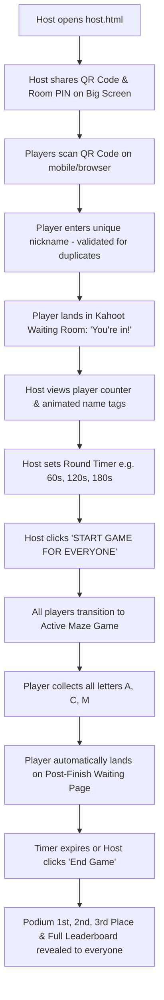

# 🏆 ACM Maze Quest — Kahoot-Style Multiplayer Platform

A Kahoot-style real-time web game where a host projects a QR code, up to 300 players join with unique nicknames, wait in a lobby, race through a dark fog-of-war maze to discover letters **A**, **C**, and **M**, return to a waiting room upon completion, and celebrate on a live podium leaderboard!

---

## 🎮 Game Content & Mechanics (Preserved)
- **Random ACM Spawns**: Letters **A**, **C**, **M** spawn at distinct random coordinates each round.
- **Medium Difficulty Labyrinth**: 25×25 procedural maze with dead ends and branching loops.
- **Hidden Until Reached**: Letters are completely invisible until the player physically steps onto their tile.
- **Dynamic Path Rendering (Fog of War)**: Only walked paths illuminate; unvisited corridors remain dark.
- **Faintly Visible Walls**: Walls emit a subtle ambient outline across the labyrinth.
- **Arbitrary Collection Order**: Collect letters in any sequence (e.g. `M ➔ A ➔ C`, `C ➔ A ➔ M`).
- **Sound Effects**: Procedural Web Audio API footsteps, wall bumps, and discovery chimes.

---

## 👥 Kahoot-Style Workflow

---

## ⚡ Instant Local Testing (Zero Setup Required)

You can test the entire Kahoot multiplayer flow right now on your machine:
1. Open [`host.html`](file:///C:/Users/athar/.gemini/antigravity/scratch/acm-maze-game/host.html) in your browser.
2. Click **👤 Open Test Player Tab** (or open [`index.html`](file:///C:/Users/athar/.gemini/antigravity/scratch/acm-maze-game/index.html) in a new tab or incognito window).
3. Enter a nickname (e.g., `Alex`). Notice your name immediately pops onto the Host screen!
4. Try entering the same nickname in another tab — it will warn that the name is already taken. Enter a unique name (e.g., `Sam`).
5. On `host.html`, select your desired time limit (e.g., `2 Minutes`) and click **🚀 START GAME FOR EVERYONE**.
6. Both player tabs instantly transition into the maze!
7. Complete finding letters **A**, **C**, and **M** in any sequence.
8. As soon as you finish, you land on the **Post-Finish Waiting Page** while the host screen tracks your finish time.
9. When the timer runs out (or the host clicks **⏹️ End Game**), the **Grand Podium (1st, 2nd, 3rd)** and full rankings appear on both the host and player screens!

---

## ☁️ Connecting 300 Mobile Phones across 4G / Wi-Fi

The game includes dual sync engines:
1. **Local Mode (Default)**: Uses `BroadcastChannel` + `localStorage` for instant testing across tabs and windows without any cloud setup.
2. **Cloud Mode (Firebase Firestore)**: To connect 300 live mobile devices across campus Wi-Fi or cellular data:
   - Create a free project at [Firebase Console](https://console.firebase.google.com).
   - Create a Firestore Database in Test Mode.
   - Paste your Firebase Web Config into [`config.js`](file:///C:/Users/athar/.gemini/antigravity/scratch/acm-maze-game/config.js).
   - Deploy to Vercel, Netlify, or GitHub Pages. The QR code on `host.html` automatically adapts to your live domain!
