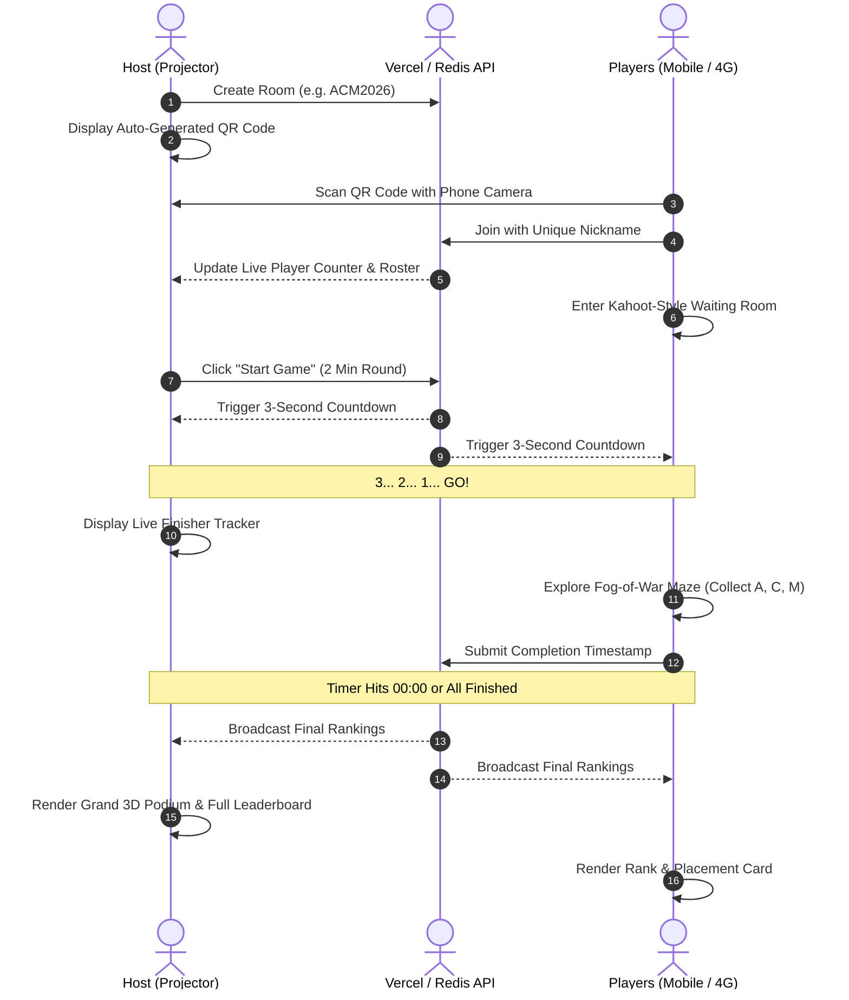

# 🏆 ACM Maze Quest

<p align="center">
  <strong>A turnkey, Kahoot-style real-time multiplayer labyrinth game engineered for interactive events, hackathons, and classroom competitions.</strong>
</p>

<p align="center">
  
  
  
  
  
</p>

---

## 📖 Table of Contents

- [Overview](#-overview)
- [Key Features](#-key-features)
- [Graphics & Atmospheric Engine](#-graphics--atmospheric-engine)
- [How the Game Works](#-how-the-game-works)
- [System Architecture](#-system-architecture)
- [Deployment Guide](#-deployment-guide)
  - [Deploy to Vercel (Recommended)](#1-deploy-to-vercel-recommended)
  - [Environment Variables](#2-environment-variables-optional)
  - [Local Development](#3-local-development)
- [Game Rules & Mechanics](#-game-rules--mechanics)
- [Repository Structure](#-repository-structure)
- [Configuration & Customization](#-configuration--customization)
- [Browser & Device Support](#-browser--device-support)
- [License](#-license)

---

## 🌟 Overview

**ACM Maze Quest** brings the thrilling, high-energy audience experience of **Kahoot** to procedural dungeon exploration. Designed specifically for audience engagement at tech events, ACM student chapter meetups, workshops, and conferences:

1. **Host opens the Big Screen**: Displays an automatic live QR code tailored for projector screens without sensitive configuration banners.
2. **Up to 300 players scan and join instantly**: Works across disparate cellular networks (4G/5G), guest Wi-Fi networks, and desktop browsers without requiring identical local subnets.
3. **Players wait in the live lobby**: Nicknames are validated in real-time with live player count updates.
4. **Host triggers synchronized countdown**: A cinematic **3... 2... 1... GO!** sequence flashes across all participant screens simultaneously.
5. **The Race Begins**: Players guide their torchbearer through a dark 25×25 procedural maze to find hidden **A**, **C**, and **M** runes before the 2-minute timer expires.
6. **Grand Podium & Leaderboard**: As soon as players finish or time runs out, an animated podium reveals the top 3 champions and complete participant rankings.

---

## ⚡ Key Features

- **🌐 Cross-Network Multiplayer**: Uses cloud persistence via Upstash Redis and Vercel Serverless Functions to eliminate split-brain issues across different mobile networks.
- **📱 Instant Zero-Install Access**: Players scan the host screen QR code with standard phone cameras; no downloads, account registrations, or app installations required.
- **⏱️ Synchronized 2-Minute Countdown**: Universal round timer strictly counting down from `02:00` to `00:00` with instant round termination and auto-transition to final standings.
- **🏁 Live Finisher Tracking & Podium**: Host projector view and mobile clients track who finishes in real time, concluding with a top 3 gold/silver/bronze podium and full ranking table.
- **🎮 Touch & Desktop Controls**: Native keyboard support (Arrow keys / WASD) with smooth auto-detecting on-screen virtual D-Pad for mobile devices.
- **🔊 Procedural Web Audio Engine**: Zero-asset audio powered entirely by native Web Audio API oscillators—footsteps, wall bumps, countdown beeps, rune collection chords, and victory fanfare.

---

## 🎨 Graphics & Atmospheric Engine

The game features a high-fidelity **Canvas 2D graphics engine** delivering a near-realistic dark dungeon aesthetic at a silky 60 FPS:

| Component | Visual Implementation |
| :--- | :--- |
| **🧱 Ancient Stone Walls** | Procedurally textured masonry with multi-tone slate palettes, sub-brick courses, staggered mortar lines, and 3D directional top-lit bevels. |
| **🌿 Weathered Moss & Lichen** | Organic lichen patches and edge wear procedurally seeded across wall surfaces. |
| **🪨 Flagstone Floor Tiles** | Hand-crafted worn stone slabs with mortar perimeters, variable stone grain, stress fractures, and specular reflections under torchlight. |
| **🔥 Dynamic Lantern Light** | Multi-tiered volumetric radial illumination (ambient gold, fiery orange, white-hot core) featuring harmonic sinusoidal flame flicker. |
| **✨ Molten Player Core & Flare** | Breathing corona halo, molten core, six rotating lens flare spikes, and orbiting dancing fire motes. |
| **👣 Ember Footprint Trail** | Thermal footsteps shifting from lemon-amber to deep smoldering crimson, accompanied by dissipating volumetric smoke puffs. |
| **🔮 Ancient Runic Glyphs (A, C, M)** | Carved stone floor medallions radiating vertical volumetric light columns, isometric sparkling dust, and concentric shockwave rings. |
| **🌌 Multi-Tier Atmosphere** | Over 130 ambient motes including wandering cool dust, rising warm embers, and bioluminescent fireflies reactive to torch proximity. |
| **🎬 Cinematic Post-Processing** | Screen-space vignette edge darkening and subtle film-grain texture overlay. |

---

## 🕹️ How the Game Works



---

## 🏗️ System Architecture

```
acm-maze-game/
├── api/
│   └── room.js          # Serverless room controller (State, Sync, Poll, Finish)
├── audio.js             # Web Audio API procedural sound synthesizer
├── config.js            # Optional Firebase fallback configuration
├── game.js              # High-fidelity Canvas 2D engine & game loop
├── host.html            # Kahoot-style Big Screen host dashboard
├── index.html           # Player responsive client (Lobby, Game, Podium)
├── maze.js              # Recursive backtracker maze generator & rune spawner
├── package.json         # Node metadata & local scripts
├── player.js            # Player controller & multiplayer state management
├── qrcode.min.js        # Standalone client-side QR generator
├── style.css            # Dark mode design system & Kahoot UI components
├── sync.js              # Network synchronization adapter (API / Local)
└── vercel.json          # Vercel deployment routing & CORS headers
```

---

## 🚀 Deployment Guide

### 1. Deploy to Vercel (Recommended)

Because this repository already contains pre-configured [`vercel.json`](vercel.json), [`package.json`](package.json), and serverless API endpoints in [`api/room.js`](api/room.js), deployment takes less than two minutes:

#### Step A: Push to GitHub
```bash
# Initialize and push to your GitHub account
git remote add origin https://github.com/<your-username>/acm-maze-game.git
git branch -M main
git push -u origin main
```

#### Step B: Import into Vercel
1. Navigate to [Vercel Dashboard](https://vercel.com/dashboard) and click **Add New... > Project**.
2. Select your imported `acm-maze-game` repository.
3. Leave default build configurations untouched (Static HTML + Serverless Functions).
4. Click **Deploy**.
5. Your game is immediately live at `https://<your-project>.vercel.app`.

---

### 2. Environment Variables (Optional)

The application includes built-in cloud persistence defaults. For custom isolated production setups, you can connect your own free [Upstash Redis](https://upstash.com/) instance:

In your **Vercel Project Settings > Environment Variables**, add:

| Variable | Description | Default |
| :--- | :--- | :--- |
| `UPSTASH_REDIS_REST_URL` | Upstash Redis REST endpoint | Pre-configured fallback |
| `UPSTASH_REDIS_REST_TOKEN` | Upstash Redis REST authorization token | Pre-configured fallback |

---

### 3. Local Development

You can run the full environment locally with any static web server:

#### Using Node.js
```bash
# Clone the repository
git clone https://github.com/<your-username>/acm-maze-game.git
cd acm-maze-game

# Serve locally
npx serve .
```

#### Using PowerShell (Windows)
```powershell
# Run the included lightweight PowerShell server script
.\server.ps1
```

Open `http://localhost:3000/host.html` for the host dashboard and `http://localhost:3000/index.html` for player sessions.

---

## 📜 Game Rules & Mechanics

| Rule | Specification |
| :--- | :--- |
| **Grid Dimensions** | 25 × 25 grid generated with Randomized Depth-First Search with subtle navigation loops for medium difficulty. |
| **Letters (A, C, M)** | Spawned at random path coordinates with significant distance constraints; completely invisible until the player physically reaches their tile. |
| **Collection Order** | Players may collect **A**, **C**, and **M** in **any sequence** (e.g., M ➔ A ➔ C). |
| **Fog of War** | Unvisited corridors remain enshrouded in darkness; floor flagstones are revealed only as they are traversed. |
| **Wall Visibility** | Walls maintain faint, spectral visibility (`~48%` opacity) allowing navigation planning without spoiling rune locations. |
| **Round Duration** | Strictly 2 Minutes (`02:00` ➔ `00:00`). When the timer concludes, unfinished runs auto-submit current progress. |

---

## ⚙️ Configuration & Customization

### Room Parameters
To adjust default room behavior or round duration, inspect [`api/room.js`](api/room.js):
```javascript
function getDefaultRoom(id) {
    return {
        id,
        status: "LOBBY",
        timeLimit: 120, // Duration in seconds (2 minutes)
        // ...
    };
}
```

### Visual Styling & Theme
Theme accents and branding can be customized in [`style.css`](style.css):
```css
:root {
    --bg-dark: #060913;
    --card-bg: rgba(15, 23, 42, 0.85);
    --border-color: rgba(56, 189, 248, 0.2);
    --accent-blue: #38bdf8;
    --color-a: #ffb703; /* Gold for Rune 'A' */
    --color-c: #00f5d4; /* Cyan for Rune 'C' */
    --color-m: #ff006e; /* Magenta for Rune 'M' */
}
```

---

## 🌐 Browser & Device Support

| Platform | Recommended Browsers | Controls |
| :--- | :--- | :--- |
| **Mobile (iOS & Android)** | Safari, Chrome, Firefox, Edge, Samsung Internet | On-Screen Responsive D-Pad & Touch Gestures |
| **Desktop / Laptop** | Chrome, Firefox, Safari, Edge, Brave, Opera | Arrow Keys, WASD, or On-Screen Controls |
| **Host / Projector Displays** | Any modern chromium or webkit browser (1080p / 4K) | Mouse & Standard UI Navigation |

---


## 👥 Team

- **Atharv Sherkar** -
- **Pranit Khndade** -
- **Vaibhav Patil Dhumal* -

---

## 📄 License

This project is licensed under the [MIT License](LICENSE)—free for educational, chapter, and commercial hackathon use.

<p align="center">
  Made with ❤️ for ACM Student Chapters & Tech Communities worldwide.
</p>
